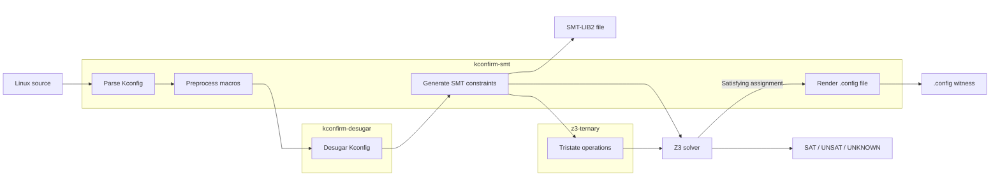

<div align="center">
  
</div>
<p align="center"><sub><em>Logo given to me by my friend, <a href="https://www.silasvibes.com/">Silas</a></em></sub></p>

# kconfirm-smt
An SMT encoding of Kconfig that supports all of the language. 

May be used as a standalone package from the `kconfirm` analzyer for other use cases.

## Architecture



E.g.:
- **Kconfig `string` is an SMT string.**
- **Kconfig `int` and `hex` are SMT integers**, bounded to signed and unsigned
  64-bit values respectively.
- Kconfig `tristate` is 2 booleans (order-encoding).
- Kconfig `bool` is also 2 booleans for comparison with tristates.
- Select's override of dependencies is supported: 
  - Enables detection of unmet dependency bugs in kconfirm's `--confirm` mode
- Config options in a `choice` are mutually-exclusive.
  - Hengelein's check on dead selects into choice members is included as a warning.
- Multiple partial definitions of configuration options are merged in `kconfirm-desugar`.
- The evaluation order of defaults is preserved.
- Visibility / prompt conditions are modeled.
  - Each config option has an additional `visibility` variable in the model (also used for writing configurations to a `.config` file)
- `imply` is supported (important when an option is not visible)

## Limitations:
- Shell macros are currently preprocessed the same way that the Linux build system does it.
  - For example, you'll need to set the environment variable `ARCH=arm` if your host machine is x86 and you want to model the arm specification. You can also use `--dump` and `--load` to save and reuse evaluated macros.

- No support yet for other software that uses Kconfig, this is currently Linux-only. 

## Testing

Compile `kconfirm-smt` (with Rust and z3 installed):
```
cargo build --release -p kconfirm-smt
```
Differential test 1: *is the model under-constrained?*
```
# generates a random solution to the SMT model,
# writes it to a config file,
# then passes it to Linux v7.2-rc3 with `KCONFIG_WARN_CHANGED_INPUT=1 make olddefconfig`
# to see if there were invalid settings changed:

bash differential_test_model_config.sh
```
Differential test 2: *is the model over-constrained?*
```
# generates a random configuration 
# from Linux v7.2-rc3 with `make randconfig`
# then adds its option settings as constraints on the SMT model
# checks if the model is still satisfiable:

bash differential_test_randconfig.sh
``` 

## Usage Examples
Compile `kconfirm-smt` (with Rust and z3 installed):
```
cargo build --release -p kconfirm-smt
```

Construct the model and output its constraints as SMT-LIB2:
```
# NOTE: this binary path is relative to the repo root 
./target/release/kconfirm-smt --linux INPUT_PATH --output-smt-lib CONSTRAINTS_FILE.smt2
```

Pass a partial .config file to add as constraints on the model:
```
# optional: compile with the `debug` feature to see the unsat core
cargo build -p kconfirm-smt --release --features debug

./target/release/kconfirm-smt --linux INPUT_PATH --add-constraints CONFIG_FRAGMENT
```

Generate a random solution to the model and output it as a valid Linux .config file:
```
./target/release/kconfirm-smt --linux INPUT_PATH --seed RANDOM_Z3_SEED --output-config OUTPUT_PATH
```
